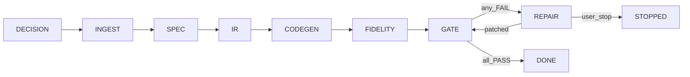
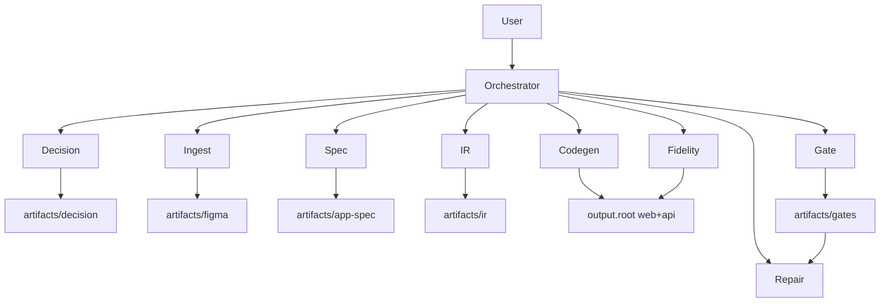

# Figma→全栈：Agent / Skill 从零拆分方案

## 设计前提（已确认）

- **还原目标**：高还原，并有自动验收（截图/几何/文本/数据）。
- **编排形态**：每个阶段一个独立 Agent，由上层 Orchestrator 串联；Skill 按需加载，不预塞全量上下文。
- **硬原则**：禁止「Figma 节点直接吐最终页面代码」；必须经中间产物再生成、再验收。
- **开工决策前置**：开始任务前必须问清并落盘三项——**技术栈（逐层）**、**鉴权方式**、**产出路径**；任一缺失不得进入拉取 / 自举 / 生成。三项均**无默认、不猜**。另须具备 Figma 来源与 `.env` 键检查（见「Decision 前置输入」），否则不得离开 DECISION 进入 INGEST。
- **零硬编码**：`.cursor/agents/**` 与 `.cursor/skills/**`（含 reference）**禁止写入硬编码与业务数据**；业务与设计值一律从 Spec / Layout IR / Visual IR / 仓库根 `.env` 在运行时读取。

## 总体架构

强制顺序（不可并行跳步）：



编排扇出（仅 Orchestrator 调阶段 Agent；阶段之间不互调）：



**分层职责**

| 层 | 放什么 | 不放什么 |
| --- | --- | --- |
| Agent（`.cursor/agents/*.md`） | 角色、状态机节点、输入/输出目录、允许调用的 Skill、完成判据 | 业务/设计字面量、长篇技法、阈值细节 |
| Skill（`.cursor/skills/<name>/SKILL.md`） | 单一功能的操作手册 + 判据原理 | 业务数据、跨阶段编排、具体屏/色/账号 |
| Scripts（确定性工具） | 拉取/抽取/对比/启动服务；值从 Spec/IR/.env 读 | 「怎么修」的决策；业务字面量写死 |
| Rules（常驻短契约） | 绝对不可违反的不变量（含零硬编码） | 操作步骤、业务举例定稿 |

中间产物是 Agent 之间的**唯一契约**：下游只读上游产物，禁止回头猜 Figma。

---

## 目录约定与状态落盘

### 三套根的职责（统一）

| 根 | 路径模式 | 职责 | 是否进 git（建议） |
| --- | --- | --- | --- |
| **artifacts** | 仓库根 `artifacts/` | 流水线中间产物与状态：决策、Figma 摘要、app-spec、IR、闸门报告、pipeline 状态 | 可提交（含报告）；大体积导出可 gitignore |
| **output.root** | 由 `spec.output` 决定 | 可运行工程（web + api） | `apps` 模式通常提交；`output-run` 模式默认不提交 |
| **.cursor** | `.cursor/agents`、`.cursor/skills`、`.cursor/rules` | 可复用手册与不变量 | 提交 |

**禁止**再用 `fixtures/<slug>/...` 作为权威路径。历史表述一律改为：

- Spec：`artifacts/app-spec/app-spec.json`
- Layout IR：`artifacts/ir/layout/<screenId>.json`
- Visual IR：`artifacts/ir/visual-ir.json`
- 闸门：`artifacts/gates/<runStamp>/`
- 状态：`artifacts/pipeline-state.json`

`slug` 仅作为 `app-spec.project.slug` 字段（派生自 Figma 文件名或用户指定），**不**再作为目录分段。

### `spec.output` 与工程路径

| `output.mode` | `output.root` | `webDir` | `apiDir` |
| --- | --- | --- | --- |
| `apps` | `.`（仓库根） | `apps/web` | `apps/api` |
| `output-run` | `output/<runId>` | `output/<runId>/web` | `output/<runId>/api` |

所有 codegen / fidelity / gate / dev-runtime **只读** `webDir` / `apiDir`，禁止写死 `apps/`。

### `artifacts/pipeline-state.json`（状态落盘）

```json
{
  "schemaVersion": 1,
  "phase": "DECISION",
  "round": 0,
  "maxRounds": 5,
  "blocked": false,
  "blockReason": null,
  "lastError": null,
  "history": [],
  "completed": {
    "DECISION": false,
    "INGEST": false,
    "SPEC": false,
    "IR": false,
    "CODEGEN": false,
    "FIDELITY": false,
    "GATE": false,
    "DONE": false
  },
  "artifacts": {
    "decision": "artifacts/decision/decision.json",
    "appSpec": "artifacts/app-spec/app-spec.json",
    "frameManifest": "artifacts/figma/frame-manifest.json",
    "layoutIrDir": "artifacts/ir/layout",
    "visualIr": "artifacts/ir/visual-ir.json",
    "gateReport": null
  }
}
```

规则：

- Orchestrator **唯一写手**写 `phase` / `completed` / `round`；阶段 Agent 只追加本阶段产物路径与 `history` 条目，不得自行改 `phase`。
- 同一时刻只允许一个阶段 Agent 改工程或 artifacts；禁止并行 CODEGEN + FIDELITY。
- 续跑：读 `phase` 与 `completed`，从第一个 `false` 的未完成阶段继续；`blocked=true` 时只允许解除阻塞或用户 abort。

---

## 零硬编码纪律（Agent / Skill 强制）

Agent 与 Skill 是**跨项目复用的操作手册**，不是某个业务原型的说明书。正文里出现任一业务/设计字面量，换 Figma 就会被照抄 → 视为未完成设计。

### 禁止写入（Agent `.md` / Skill `SKILL.md` / `reference.md`）

| 类别 | 示例（说明用，正文不得出现具体业务值） |
| --- | --- |
| 屏 / 路由 / 导航 | 屏名、屏 id、route 字符串、侧栏标签 |
| 字段 / 文案 | 表头、表单 label、按钮文案、placeholder、品牌 title/subtitle |
| 几何 / 视觉 | 坐标、宽高、间距、百分比、字号、色值（含 hex/rgb）、圆角 |
| 样例 / 凭证 | sample 行、seed 账号密码、JWT secret、token |
| 项目身份 | 具体 slug、产品名、Figma fileKey、客户名 |
| 路径默认当真理 | 把某一业务工程的绝对路径或「默认一定是 apps/web」写进非 output-path-interview 的正文 |

### 允许写入

- **工具选项集**：栈矩阵枚举、鉴权枚举、产出模式枚举、闸门命令名、状态机状态名、FAIL 码。
- **派生说法**：写「从 `spec.screens[].route` 读取」「色值来自生成 token」「账号来自 `spec.seedAdmin` 或 `.env`」，用 `<placeholder>` 举例。
- **结构契约**：JSON 字段名、目录模式（如 `artifacts/ir/layout/<screenId>.json`）、env **键名**（不是键值）。

### 落点与强制手段

- **常驻 Rule**：一条不变量——「Agent/Skill/流程文档零硬编码；业务值只进 Spec/IR/.env」。
- **机械校验（可执行设计）**：
  1. **结构白名单**：允许出现的字面量仅限工具选项集 + FAIL 码 + 字段路径 + 目录模式中的固定段（`artifacts`、`apps`、`output` 等）。
  2. **模式黑名单**：匹配 `#RGB` / `rgb(` / 疑似密码赋值 / 绝对盘符业务路径 → FAIL。
  3. **交叉比对（可选增强）**：若仓库存在 `artifacts/app-spec/app-spec.json`，将其业务叶子（屏名、路由、文案）建成禁止集；扫 agents/skills 命中即 FAIL。无 Spec 时跳过交叉比对，仅跑 1+2。
  4. 工具选项集维护在单一 `stack-matrix` 清单文件，lint 读取该白名单，避免误杀 `react-vite` 等合法枚举。
- **写作时自检**：删掉当前 artifacts 后，手册是否仍正确？若否，说明混入了业务数据。

### 对阶段 Agent 的额外约束

- Orchestrator / Decision / Spec 等**不得**在 agent 文件里粘贴某次访谈得到的具体栈选择结果或屏清单作为「示例定稿」。
- Repair / Fidelity skill 写「失败类型 → 修法」时，用 FAIL 码与字段路径，不写「把某某页的标题改成某某」。

---

## 开工前：决策闸门（DECISION）

流水线的**第一个强制人工闸门**，排在 INGEST 之前。Orchestrator 发现决策不完整时，只调 Decision Agent，**禁止**猜默认或跳过。

### Decision 前置输入（与三项决策并列，缺一不可进入 INGEST）

| 项 | 落盘位置 | 规则 |
| --- | --- | --- |
| Figma 来源 | `decision.figma.fileKey`（可由 URL 解析） | 无默认；未提供则 `blocked=true` |
| 栈 / 鉴权 / 产出 | `decision.stack` / `auth` / `output` | 见下节 A/B/C |
| `.env` 键存在性 | 不写密钥进 decision；只记录检查结果 | 必检键名见下表；缺键则 blocked，提示用户补 `.env`，**不**在聊天中回显值 |

必检 env **键名**（值永不进 Agent/Skill 正文）：

| 键名 | 何时必检 |
| --- | --- |
| `FIGMA_ACCESS_TOKEN` | 进入 INGEST 前 |
| `WEB_URL` / `API_URL` | 进入 GATE 前（可由 runtime 写入 `.env`，但键须存在） |
| `POSTGRES_URL` | `stack.database=postgresql` 且进入 CODEGEN/migrate 前 |
| `MYSQL_URL` 或 `MYSQL_JDBC_URL` | `stack.database=mysql` 且进入 CODEGEN/migrate 前 |
| `JWT_SECRET` | `auth.mode=jwt` 且进入 CODEGEN 前 |
| 闸门账号键（如 `GATE_USER` / `GATE_PASS`）或 Spec `seedAdmin` | `auth.mode=jwt` 且进入 GATE 前（二选一齐即可） |

决策分三块，**每块单独问清**（栈内部还要逐层问）；全部写入 **`artifacts/decision/decision.json`** 后，再由脚本/Spec 阶段**合并**进 `app-spec` 的对应字段（见「决策与 Spec 合并」）。

### A. 技术栈（逐层，无默认）

提问顺序（每层单独一问，缺一层就停）：

1. **后端语言** `language`：`node` / `java`
2. **前端框架** `frontend`：`react-vite` / `vue-vite`
3. **后端框架** `backend`：随语言联动
   - node → `nestjs` / `express`
   - java → `spring-boot`
4. **数据库** `database`：随语言联动
   - node → `postgresql`
   - java → `mysql`
5. **ORM** `orm`：随语言联动，禁止跨生态
   - node → `prisma`
   - java → `jpa` / `mybatis`（选 Java 时不得出现 Prisma）
6. **UI 组件库** `ui`：随前端联动，**闭合枚举**，无默认
   - `react-vite` → `antd` / `mui` / `mantine`
   - `vue-vite` → `element-plus` / `ant-design-vue`

选齐后对照**合法栈矩阵**解析出 `stack.id`；矩阵外组合拒绝并提示合法表，绝不静默降级。

**合法栈矩阵**（`id` = 下列五行组合之一；`ui` 须属于该行 `frontend` 的允许集合）：

| ID | language | frontend | backend | database | orm | 允许的 `ui` |
| --- | --- | --- | --- | --- | --- | --- |
| A | node | react-vite | nestjs | postgresql | prisma | antd, mui, mantine |
| A2 | node | react-vite | express | postgresql | prisma | antd, mui, mantine |
| B | node | vue-vite | nestjs | postgresql | prisma | element-plus, ant-design-vue |
| C | java | react-vite | spring-boot | mysql | jpa | antd, mui, mantine |
| D | java | vue-vite | spring-boot | mysql | mybatis | element-plus, ant-design-vue |

校验算法：

1. 用 `language+frontend+backend+database+orm` 唯一匹配矩阵行 → 得到 `id`；匹配失败 → 拒绝。
2. 断言 `ui ∈ 该行允许的 ui`；失败 → 拒绝（**ui 不单独产生新 id**，但参与合法性）。
3. 写入 `spec.stack = { id, language, frontend, backend, database, orm, ui }`。

CLI `--stack <ID>` 仅作捷径：仍须再问（或显式传入）`ui`，并与矩阵一致。

### B. 鉴权方式（单独一问，无默认）

| 值 | 含义 | 下游影响 |
| --- | --- | --- |
| `jwt` | JWT 登录态 | 生成 auth 模块、登录屏接线、受保护路由；闸门用 `seedAdmin` / env 账号登录；前端 `auth.storageKey` 写入 Spec |
| `none` | 无鉴权 | 不生成登录强制拦截；闸门可直达业务屏；若原型有登录帧可保留 UI，但不做 token 校验 |

纪律：

- **禁止默认 JWT 或默认无鉴权**；用户未答则停在 DECISION。
- 选 `jwt` 时：`seedAdmin`（或闸门 env 账号）与 `auth.storageKey` 在 **SPEC** 补齐；缺则 **硬阻塞离开 SPEC**（见状态转换）。不得静默编造密码进文档。
- 凭证只进仓库根 `.env` / Spec 的 seed 字段，不进 Skill 正文与聊天长文。

写入：`auth = { mode: "jwt" | "none", storageKey?: string }`（`storageKey` 可在 SPEC 从 `project.slug` 派生为 `<slug>.auth.token` 形式的**模式**，但 `mode` 必须本闸门选定）。

本阶段鉴权范围仅 `jwt` | `none`（无角色/刷新/RBAC）；扩展另开变更，不在本宪章默许。

### C. 产出路径（单独一问，无默认）

| 值 | 根路径约定 | 适用 |
| --- | --- | --- |
| `apps` | 前端 `apps/web`，后端 `apps/api` | 仓库内常驻工程 |
| `output-run` | `output/<runId>/web` + `output/<runId>/api` | 一次运行隔离产物 |

纪律：

- **禁止默认写进 `apps/`**；未选则停。
- 选定后写入 `output = { mode, root, webDir, apiDir, runId? }`。
- 选 `output-run` 时由脚本生成 `runId`（时间戳或 UUID），回写；用户可指定 runId。
- 若磁盘已有 `apps/web` 且用户选 `output-run`：**允许**，互不覆盖；若选 `apps` 且目标非空 → 询问覆盖 / 中止（默认中止，不静默覆盖）。

### 决策与 Spec 合并

| 阶段 | 文件 | 内容 |
| --- | --- | --- |
| DECISION 完成 | `artifacts/decision/decision.json` | `schemaVersion`、`figma`、`stack`、`auth`、`output`、`envCheck` |
| SPEC 开始 | 读取 decision + INGEST 产物 | 生成/更新 `artifacts/app-spec/app-spec.json` |
| 合并规则 | — | `app-spec.stack|auth|output` **必须深拷贝自 decision**；SPEC 不得改写三项；仅追加上业务面（screens/entities/…）与 jwt 的 `seedAdmin` / `storageKey` |

DECISION 完成时**尚无**完整 app-spec；`completed.DECISION=true` 的判据是 decision.json 校验通过，不是 app-spec 存在。

### 与后续步骤的衔接

- 空目录自举：`--frontend` / `--ui` 取自栈决策；工程铺到 `output.webDir`。
- Codegen：按 `stack` 分发 adapter，按 `auth.mode` 决定是否生成 JWT 模块，产物落到 `output.root`。
- Gate / Repair：登录策略读 `auth.mode`；服务探活与截图目标读 env `WEB_URL`（对应 `webDir` 所起服务）。
- 常驻 Rule：**决策三项 + Figma 来源 + 阶段所需 env 键未齐不得开跑**。

---

## 最小 JSON Schema（契约）

下列为 **最小必填集**；校验失败 → 当前阶段 FAIL，不得进入下一态。`schemaVersion` 缺省按 1。

### `artifacts/decision/decision.json`

```ts
{
  schemaVersion: 1,
  figma: { fileKey: string, sourceUrl?: string },
  stack: {
    id: "A" | "A2" | "B" | "C" | "D",
    language: "node" | "java",
    frontend: "react-vite" | "vue-vite",
    backend: "nestjs" | "express" | "spring-boot",
    database: "postgresql" | "mysql",
    orm: "prisma" | "jpa" | "mybatis",
    ui: "antd" | "mui" | "mantine" | "element-plus" | "ant-design-vue"
  },
  auth: { mode: "jwt" | "none" },
  output: {
    mode: "apps" | "output-run",
    root: string,
    webDir: string,
    apiDir: string,
    runId?: string
  },
  envCheck: { ok: boolean, missingKeys: string[] }
}
```

### `artifacts/app-spec/app-spec.json`

```ts
{
  schemaVersion: 1,
  project: { slug: string, name?: string },
  stack: /* 同 decision.stack，只读合并 */,
  auth: {
    mode: "jwt" | "none",
    storageKey?: string  // jwt 时离开 SPEC 前必填
  },
  output: /* 同 decision.output */,
  seedAdmin?: { username: string, passwordEnvKey?: string }, // jwt：username 必填；密码优先 env
  screens: Array<{
    id: string,
    name: string,
    route: string,
    type: "list" | "form" | "detail" | "dashboard" | "login" | "modal" | "chrome" | "other",
    frameId: string,          // 对应 frame-manifest
    entityId?: string,
    template?: string
  }>,
  entities: Array<{
    id: string,
    name: string,
    fields: Array<{ id: string, name: string, type: string, required?: boolean }>
  }>,
  navigation?: { items: Array<{ screenId: string, label: string }> },
  stats?: Array<{              // codegen-db / gate-data 闭环
    id: string,
    op: "count" | "sum" | "avg",
    entityId: string,
    fieldId?: string
  }>,
  needsReview: boolean         // true 时不得离开 SPEC
}
```

### `artifacts/figma/frame-manifest.json`

```ts
{
  schemaVersion: 1,
  fileKey: string,
  frames: Array<{
    id: string,
    name: string,
    included: boolean,         // 人工确认后的纳入标记
    width: number,
    height: number
  }>,
  assetsManifestPath?: string  // artifacts/figma/assets-manifest.json
}
```

### Layout IR — `artifacts/ir/layout/<screenId>.json`

```ts
{
  schemaVersion: 1,
  screenId: string,
  frameId: string,
  bounds: { x: number, y: number, width: number, height: number },
  tree: object,                // 完整子树；节点含 id/type/bounds/fills?/strokes?/text?/children?
  texts: Array<{ nodeId: string, characters: string, style?: object, bounds: object }>,
  icons: Array<{ nodeId: string, exportable: boolean }>,
  controls?: Array<{ nodeId: string, role: string, bounds: object }>
}
```

**硬约束**：`spec.screens[]` 中每个 `included` 业务屏（非纯 chrome 可配置）必须存在对应 Layout IR 文件，否则 IR 阶段 FAIL。

### Visual IR — `artifacts/ir/visual-ir.json`

```ts
{
  schemaVersion: 1,
  tokens: object,              // 由 Layout IR 派生的设计 token 键值；推不出的键缺席
  chrome?: { sidebar?: object, header?: object },
  screens: Array<{ screenId: string, template?: string }>,
  modals?: Array<{ screenId: string, triggerScreenId?: string }>
}
```

### Gate report — `artifacts/gates/<runStamp>/gate-report.json`

```ts
{
  schemaVersion: 1,
  runStamp: string,
  overall: "PASS" | "FAIL",
  legs: {
    pixel: { status: "PASS" | "FAIL", failures: Failure[] },
    geom:  { status: "PASS" | "FAIL", failures: Failure[] },
    text:  { status: "PASS" | "FAIL", failures: Failure[] },
    data:  { status: "PASS" | "FAIL", failures: Failure[] }
  },
  runtime: { webOk: boolean, apiOk: boolean }
}
// Failure = { code: string, screenId?: string, path?: string, message: string, evidence?: string }
```

合成规则：**四门 AND** + `runtime.webOk && runtime.apiOk` → `overall=PASS`；任一门 FAIL 或 runtime 失败 → `overall=FAIL`。不允许配置「跳过某门」除非 `pipeline-state` 显式记录用户批准的 `skipLegs`（默认空；试点若缺 chart/table 能力见「能力缺口」）。

---

## 流水线步骤（状态机）

### 状态总表

| 状态 | 负责 Agent | 产出 | 完成判据（文件级） | 人工闸门 |
| --- | --- | --- | --- | --- |
| `DECISION` | Decision | `artifacts/decision/decision.json` | schema 过校验 + `envCheck` 满足 INGEST 前键 + 矩阵含 ui | 栈逐层 + 鉴权 + 产出 + Figma 来源 |
| `INGEST` | Ingest | `frame-manifest` + 节点摘要 + assets | manifest 存在且至少一帧 `included` 待确认后为 true | 确认纳入哪些 Frame |
| `SPEC` | Spec | `app-spec.json` | `needsReview=false`；jwt 时 `seedAdmin`+`storageKey` 齐 | 确认业务面 |
| `IR` | IR | layout/* + visual-ir | 每个纳入屏有 Layout IR；visual-ir 存在 | 缺帧 IR 即停（自动 blocked） |
| `CODEGEN` | Codegen | `webDir`+`apiDir` 可编译骨架 | 构建/类型检查脚本 exit 0；jwt 时 JWT 模块存在 | 无 |
| `FIDELITY` | Fidelity | 按 IR 写实后的页面源码 | 纳入屏均已写屏标记（见下）且无「无 IR 写屏」 | 无 |
| `GATE` | Gate | gate-report | `overall` 已写出 | 无 |
| `REPAIR` | Repair | 定点补丁 | 本轮至少消费一份 FAIL 列表并落盘修补记录 | 每轮结束问是否继续 |
| `DONE` | Orchestrator | — | `overall=PASS` 且 runtime 可达 + 用户交付确认 | 交付确认 |
| `STOPPED` | Orchestrator | — | 用户主动停止（可非 PASS） | — |

Fidelity 写屏粒度：**按 `screenId` 增量**；每屏完成在 `artifacts/ir/fidelity-progress.json` 记 `{ screenId, done: true }`。无对应 Layout IR 禁止标记 done。

### 允许的边

| 从 | 到 | 条件 |
| --- | --- | --- |
| DECISION | INGEST | decision 完成且未 blocked |
| INGEST | SPEC | 帧确认完成 |
| SPEC | IR | needsReview=false；jwt 种子硬条件满足 |
| IR | CODEGEN | 全纳入屏 IR 齐 |
| CODEGEN | FIDELITY | 骨架可编译 |
| FIDELITY | GATE | 纳入屏 fidelity-progress 全 done |
| GATE | DONE | overall=PASS |
| GATE | REPAIR | overall=FAIL |
| REPAIR | GATE | 用户同意继续 **或** round 未达 maxRounds 且默认续跑「先再跑一轮 GATE」 |
| REPAIR | FIDELITY | FAIL 码属于 `FIDELITY_*` / 视觉类（见 FAIL 码表） |
| REPAIR | CODEGEN | FAIL 码属于 `CODEGEN_*` / 骨架缺失类 |
| REPAIR | STOPPED | 用户明确停止 |
| 任一 | 同态 | `blocked=true` 解除前不得前进 |

禁止：跳过 DECISION；INGEST 前改 `output.root` 工程；无 IR 进入 FIDELITY；GATE 未跑声称 DONE。

### 轮次与停止

- `round`：每次进入 REPAIR 前 `round += 1`（GATE 首次失败进入 REPAIR 时从 0→1）。
- `maxRounds` 默认 **5**；达到后 `blocked=true`，`blockReason=MAX_ROUNDS`，只允许用户提高上限或 STOPPED。
- 用户说停止：进入 `STOPPED`（不等于 DONE）；交付物可保留，成功标准不满足。

### 人工闸门话术契约（`pipeline-orchestrate`）

| 闸门 | 必须展示的摘要 | 确认用语 | 拒绝时回退 |
| --- | --- | --- | --- |
| DECISION | 栈六层+id、auth.mode、output.mode、fileKey 掩码、env 缺键列表 | 用户逐项作答即写入；无「一键默认」 | 停在 DECISION |
| INGEST | 帧 id/name/尺寸列表 | 「确认纳入：…」或勾选结果 | 可改 `included`；全部 false → blocked |
| SPEC | 实体、路由、screens 表、jwt 时 seed 用户名（密码仅 env 键名） | 「Spec 确认」 | 回 SPEC，`needsReview=true` |
| REPAIR | 本轮 FAIL 码聚合、拟修落点（字段路径） | 「继续下一轮」/「停止」 | 停止 → STOPPED |
| DONE | gate overall、WEB_URL | 「交付确认」 | 可回 REPAIR（少见） |

禁止项：`--yes` 跳过 DECISION；静默把未答项填成 jwt+apps。

### 硬阻塞点（摘录）

| 条件 | 阻塞态 | 解除 |
| --- | --- | --- |
| 矩阵外栈或 ui 不在允许集 | DECISION | 重选 |
| 缺 `FIGMA_ACCESS_TOKEN` | DECISION→INGEST | 补 `.env` |
| jwt 无 seedAdmin 且无 GATE 账号 env | SPEC | 用户提供 |
| 纳入屏缺 Layout IR | IR | 重抽或排除该帧 |
| 构建失败 | CODEGEN | 修生成物或重跑 codegen |
| runtime 探活失败 | GATE | 修 dev-runtime / 端口 |
| maxRounds | REPAIR | 用户提额或停止 |

---

## Agents 清单（一阶段一 Agent）

### 0. `figma-decision`

- **职责**：Figma 来源 + 栈访谈 + 鉴权访谈 + 产出路径访谈 + env 键检查；写入 `decision.json`。
- **加载 Skill**：`stack-interview`、`auth-interview`、`output-path-interview`（Figma/env 检查可放在 `pipeline-orchestrate` 或 Decision 内联步骤）。
- **完成判据**：decision schema 过校验；`stack.id` 合法且 ui∈允许集；`auth.mode` 已选；`output.mode/root` 已选；`figma.fileKey` 已有；INGEST 前 env 键齐。
- **禁止**：替用户选默认；套餐甩栈；悄悄写成 jwt+apps。

### 1. `figma-orchestrator`

- **职责**：读写 `pipeline-state.json`、人工确认点、轮次计数、禁止跳步；启动时决策不全则强制 DECISION。
- **加载 Skill**：仅 `pipeline-orchestrate`。
- **完成判据**：`DONE` 且 GATE overall=PASS。

### 2. `figma-ingest`

- **职责**：解析 fileKey；导出帧清单与资产。
- **加载 Skill**：`figma-fetch`、`asset-export`。
- **前置**：`completed.DECISION`。
- **完成判据**：`frame-manifest.json` 存在；用户确认后至少一帧 `included=true`。

### 3. `figma-spec`

- **职责**：合并 decision → 推断屏/实体/路由/导航；**不再重问**栈/鉴权模式/产出路径；jwt 时确认 `seedAdmin` 与 `storageKey`。
- **加载 Skill**：`app-spec-authoring`。
- **完成判据**：`needsReview=false`；jwt 硬条件满足。

### 4. `figma-ir`

- **加载 Skill**：`layout-ir-extract`、`visual-ir-extract`。
- **硬约束**：无 Layout IR 不写该屏。
- **完成判据**：纳入屏 layout 文件齐 + `visual-ir.json` 存在。

### 5. `figma-codegen`

- **职责**：按 stack + auth.mode + output 生成工程；jwt 才铺 auth；**页面空壳** = 路由 + 布局壳 + 按 template 的空白页（含所选 ui 的 Provider），**不含** IR 几何写实。
- **加载 Skill**：`codegen-web`、`codegen-api`、`codegen-db`。
- **文件所有权**：带生成标记的骨架文件；Fidelity 可改页面实现，但不得删除生成标记边界外的契约文件（api client / 路由表由 codegen 维护，fidelity 只填 page body）。
- **完成判据**：web/api 安装依赖后构建 exit 0；migrate/seed 由 codegen-db 在本阶段触发（连接串读 env 键）。

### 6. `figma-fidelity`

- **加载 Skill**：`screen-layout-from-ir`、`token-binding`、`modal-fidelity`。
- **硬约束**：只消费生成物与 IR；组件库 = `stack.ui`。
- **完成判据**：`fidelity-progress` 覆盖所有纳入业务屏。

### 7. `figma-gate`

- **加载 Skill**：`gate-pixel`、`gate-geom`、`gate-text`、`gate-data`、`dev-runtime`。
- **行为**：jwt 按 seed/env 登录；none 跳过登录；必须先 runtime 探活再采集。
- **完成判据**：写出 `gate-report.json`（不论 PASS/FAIL）。

### 8. `figma-repair`

- **加载 Skill**：`repair-from-report`（按 FAIL 码临时加载 fidelity/codegen）。
- **纪律**：每轮结束先探活再提问；按码表路由回 FIDELITY / CODEGEN / 仅重跑 GATE。

---

## Skills 清单（一 Skill 一功能）与 I/O 大纲

编号全局唯一。每个 Skill 须具备：输入路径、输出路径、完成判据（正文仍零硬编码）。

### 编排与运行

1. **pipeline-orchestrate**
   - 输入：`artifacts/pipeline-state.json`（可无则初始化）
   - 输出：更新后的 state；人工闸门摘要
   - 判据：不跳步；DECISION 未完成不调下游
2. **dev-runtime**
   - 输入：`spec.output`、env `API_URL`/`WEB_URL`、端口键（如 `API_PORT`/`WEB_PORT`）
   - 输出：进程起来；探活 HTTP 2xx/约定健康路径
   - 判据：先 api 后 web；已占用端口则按端口杀旧再起或报 `RUNTIME_PORT_BUSY`；Gate 必须经本 Skill 确认 `webOk/apiOk`
   - 失败归属：探活失败 → runtime FAIL（写入 gate-report.runtime），不计入四门视觉腿

### 开工决策

3. **stack-interview** — 逐层提问、联动过滤、矩阵+ui 校验、写入 `decision.stack`
4. **auth-interview** — 写入 `decision.auth.mode`；说明对 codegen/gate 影响；不编造账号
5. **output-path-interview** — 写入 `decision.output`；生成/校验 runId

### 规格与摄入

6. **app-spec-authoring**
   - 输入：decision + frame-manifest
   - 输出：`app-spec.json`
   - 判据：决策三项只校验不改写；`needsReview=false`；jwt 时 seed/storageKey 齐
7. **figma-fetch**
   - 输入：`fileKey`、`FIGMA_ACCESS_TOKEN`
   - 输出：节点摘要 + 原始缓存（路径在 artifacts/figma）
   - 判据：429/5xx → 指数退避；耗尽 → `INGEST_FIGMA_RATE_LIMIT` blocked
8. **asset-export**
   - 输入：frame-manifest 中 exportable 节点
   - 输出：文件 + `assets-manifest.json`
   - 判据：manifest 中每个导出 id 有文件或显式 skip 原因

### 中间表示

9. **layout-ir-extract**
   - 输入：纳入屏的 `frameId`
   - 输出：`artifacts/ir/layout/<screenId>.json`
   - 判据：bounds/tree/texts 必填；与 screenId 对齐
10. **visual-ir-extract**
    - 输入：全部 Layout IR
    - 输出：`visual-ir.json`
    - 判据：tokens 无静默占位常量；推不出则键缺席

### 代码生成

11. **codegen-web** — 输出到 `webDir`；按 frontend+ui；空壳定义见 Codegen Agent
12. **codegen-api** — 输出到 `apiDir`；仅 jwt 生成 JWT 模块
13. **codegen-db**
    - 输入：`entities` + `stats` + env 连接键
    - 输出：schema + seed；执行 migrate/seed
    - 判据：`stats[]` 中每个 op 可在 seed/API 聚合中闭环；缺 stats 时允许空数组但 gate-data 对声明了的 stats 必查

### 视觉还原

14. **screen-layout-from-ir**
    - 输入：Layout IR + 空壳页路径
    - 输出：写实后的页面实现；更新 fidelity-progress
    - 判据：几何/结构来自 IR 字段路径，不手编业务文案
15. **token-binding**
    - 输入：visual-ir.tokens
    - 输出：生成 token 样式文件（落在 webDir）
    - 判据：禁止兜底硬编码色值
16. **modal-fidelity**
    - 输入：visual-ir.modals + 对应 Layout IR
    - 输出：弹窗写实
    - 判据：无 modal IR 不写该弹窗

### 闸门

17. **gate-pixel** — 见「闸门判据」
18. **gate-geom**
19. **gate-text**
20. **gate-data**

### 修复

21. **repair-from-report**
    - 输入：gate-report.failures[]
    - 输出：修补记录 `artifacts/gates/<runStamp>/repair-log.json` + 代码改动
    - 判据：每条处理记录含 `code` 与落点 path；禁止按屏名散文指令

可选后续（能力缺口策略见下）：`chart-fidelity`、`table-column-mapping`、`auth-seed`。

### 能力缺口与验收边界

若试点屏 `type=dashboard` 且尚未实现 `chart-fidelity`：Gate **不得**对图表区域宣称 PASS；应报 `GATE_DATA_STATS_GAP` 或 `FIDELITY_CHART_UNSUPPORTED`，overall=FAIL，或经用户书面批准写入 `skipLegs`/`skipScreenIds`（记入 state）后排除该屏。禁止假装全过。

---

## 闸门判据、合成与 FAIL 码

### 四门分工（避免重叠/真空）

| 门 | 输入 | 断言焦点 | 不负责 |
| --- | --- | --- | --- |
| pixel | 对照截图 vs 运行截图 | 画布尺寸、整页像素差、平坦背景异常 | 单控件框、单文本盒 |
| geom | Layout IR controls/bounds vs DOM 框 | 控件框、弹窗白卡尺寸 | 像素纹理、文案内容 |
| text | Layout IR texts vs DOM 文本盒 | 文案内容、字号/字色盒 | 位图像素 |
| data | app-spec 字段/stats/API vs DOM/API | 闭环、回填、活数据/聚合 | 纯视觉几何 |

阈值一律来自仓库根 `.env` **键名**（例：`GATE_PIXEL_SSIM_MIN`、`GATE_GEOM_TOL_PX`、`GATE_TEXT_SIZE_TOL_PX`）；Skill 正文只写键名。

采集契约：建议单趟浏览器会话产出 `artifacts/gates/<runStamp>/capture.json`（截图 + DOM 盒）；四门只消费该快照。缺 capture → `GATE_CAPTURE_MISSING`。

### FAIL 码表（Repair 路由）

| 码 | 门/来源 | 默认回退 |
| --- | --- | --- |
| `RUNTIME_NOT_UP` | runtime | 修 dev-runtime，重 GATE |
| `RUNTIME_PORT_BUSY` | runtime | 清端口或改 env 端口 |
| `GATE_CAPTURE_MISSING` | gate | 重采集 |
| `GATE_PIXEL_SIZE` | pixel | FIDELITY |
| `GATE_PIXEL_DIFF` | pixel | FIDELITY |
| `GATE_PIXEL_FLAT_BG` | pixel | FIDELITY |
| `GATE_GEOM_CONTROL` | geom | FIDELITY |
| `GATE_GEOM_MODAL` | geom | FIDELITY + modal-fidelity |
| `GATE_TEXT_CONTENT` | text | FIDELITY / SPEC 若字段源错误 |
| `GATE_TEXT_STYLE` | text | token-binding / FIDELITY |
| `GATE_DATA_LOOP` | data | CODEGEN / SPEC |
| `GATE_DATA_LIVE` | data | CODEGEN-db / API |
| `GATE_DATA_STATS_GAP` | data | 补 stats 或 skip 批准 |
| `FIDELITY_CHART_UNSUPPORTED` | fidelity/能力 | 可选 skill 或 skip 批准 |
| `CODEGEN_BUILD_FAIL` | codegen | CODEGEN |
| `INGEST_FIGMA_RATE_LIMIT` | ingest | 等待重试 / blocked |
| `IR_SCREEN_MISSING` | ir | IR 重抽或改 included |
| `SPEC_NEEDS_REVIEW` | spec | SPEC |
| `AUTH_SEED_MISSING` | spec/gate | SPEC |
| `MAX_ROUNDS` | orchestrator | 用户决策 |

---

## 错误与降级策略

| 场景 | 行为 |
| --- | --- |
| Figma 429/5xx | 退避重试 N 次（次数来自 env 键）；仍失败 → blocked + `INGEST_FIGMA_RATE_LIMIT` |
| 矩阵外栈 | 拒绝写入 decision；提示合法表 |
| 用户拒确认 Frame | 可改选型；零纳入 → blocked |
| 用户拒确认 Spec | `needsReview` 保持 true |
| 缺帧 IR | IR blocked，列出 screenId |
| Gate 持续 FAIL | REPAIR 循环直至 PASS、STOPPED 或 MAX_ROUNDS |
| 已有 apps/ 且选 output-run | 允许并行存在 |
| 已有 apps/ 且选 apps | 询问覆盖；默认中止 |
| 缺可选 chart/table skill | 见「能力缺口」；禁止假 PASS |

---

## Agent ↔ Skill 绑定（加载矩阵）

- Orchestrator → `pipeline-orchestrate`
- Decision → `stack-interview` + `auth-interview` + `output-path-interview`
- Ingest → `figma-fetch` + `asset-export`
- Spec → `app-spec-authoring`
- IR → `layout-ir-extract` + `visual-ir-extract`
- Codegen → `codegen-web` + `codegen-api` + `codegen-db`
- Fidelity → `screen-layout-from-ir` + `token-binding` + `modal-fidelity`
- Gate → `gate-pixel` + `gate-geom` + `gate-text` + `gate-data` + `dev-runtime`
- Repair → `repair-from-report`（+ 按失败码临时加载）

---

## 落地实现顺序（建议）

1. **定决策契约**：decision schema + 三个 interview Skill + `figma-decision` + 目录/state 落盘。
2. **定其它契约**：app-spec / Layout IR / Visual IR / gate-report（本文最小集）落地为 JSON Schema 文件。
3. **写常驻 Rules**：决策无默认、未齐不得开跑、零硬编码、无 IR 不写屏、只消费生成物、闸门未过不算完成、密钥只进 `.env`。
4. **落地零硬编码 lint**：白名单 + 模式黑名单 + 可选 Spec 交叉比对。
5. **实现 Scripts**：路径读 `spec.output`；auth 读 `spec.auth.mode`；脚本不写业务字面量。
6. **写其余 Skill / Agent**（写完即跑 lint）。
7. **小原型打通**：DECISION → … → DONE（含 jwt/none 与 apps/output-run 合法组合）。
8. **沉淀修复策略库**（按 FAIL 码）。

---

## Agent / Skill 写作规范

- **description** 写清何时用 / 不用。
- 正文只写本功能；跨阶段一句话甩给状态/Agent。
- **禁止**在 Agent 与 Skill（含 reference）写入硬编码与业务数据。
- 栈/鉴权/路径的**工具选项集**可以进对应 interview Skill；其它 Skill 一律「读 Spec 字段」。
- 举例只用 `<placeholder>` 或字段路径（如 `spec.screens[].name`），不用真实业务句子。

---

## 成功标准

- 不选栈 / 不选鉴权 / 不选产出路径 / 无 fileKey / 缺阶段必需 env 键 → 无法进入对应下游。
- 选 `none` 时不生成强制 JWT；选 `output-run` 时不污染 `apps/`。
- **换 Figma / 换业务后，Agent 与 Skill 正文无需改字**——业务变化只体现在 Spec/IR/.env。
- Agent/Skill 过零硬编码 lint；视觉交付 = GATE overall PASS + 交付确认，而不是「代码生成完了」。
- 能力未实现的屏不得靠沉默跳过装成全过。
